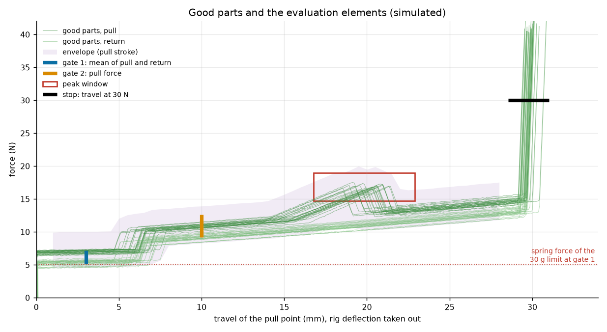

# door-handle-force-travel-test

End-of-line force-travel test of a painted exterior car door-handle unit: which evaluation windows separate assembly defects from good handles, what the rig must be able to measure, and what the test costs a three-shift line.

> **Simulated study, no hardware.** The handle, the test rig, the defects, the line and every "measurement" here are models. All part values and their spreads are illustrative. That handle lines run a force-travel test at the end of the line is an assumption of this study, not a published fact about any plant. The regulation and standards content comes from the public sources in [docs/SOURCES.md](docs/SOURCES.md); what was not read is listed there. The PLC code compiles in TIA Portal V18 with 0 errors and 0 warnings (record in `results/tia_compile.txt`); in the tests it runs through a translator in Python. A self-checking test project with these blocks ran in S7-PLCSIM Advanced under TIA Portal V20: 20 of 20 bench cases passed ([docs/PLCSIM_RUN.md](docs/PLCSIM_RUN.md)). That is a simulated CPU; the code was not run on a real PLC.

## The question

The unit is a handle lever on a pivot with a torsion return spring, a counterweight and a lever that pulls the latch cable. The station pulls the grip once to the end stop and lets it return, and records force against travel.

Which force-travel evaluation windows separate the real assembly defects from good handles, given the rig's own measurement capability, and what do those windows cost in false rejects and cycle time on a three-shift line?

## The answer

1. **The spring has an engineering lower limit, and it comes from the 30 g rule.** UN Regulation No. 11 (6.1.4) and FMVSS 206 (S4.1.1.4) ask that the latch system, with its activation device, stays latched at 30 g. For the modelled handle (grip 1.82 g m out of balance after the counterweight) the inertia torque at 30 g is 0.535 N m. With spring torques averaged over rest and release position, as Annex 4 of the regulation prescribes, the nominal spring gives 0.650 N m and holds 36.4 g. The preload may fall to 0.492 N m, 81 % of nominal. The spring of the other handle variant (1.6 mm wire instead of 1.8 mm) gives 62 % and holds 22.7 g: it fits, it returns the handle, and it is a safety defect. Without the counterweight the handle would need 1.33 N m.

2. **Windows on the pull stroke plus one element on the return stroke are the only method that finds every spring defect; each simpler method has a blind spot.** All four methods were set to the same false-reject target (0.2 % of good parts) and then tried on the same defective parts:

| Defect | Peak force only | Pull-stroke windows | Windows + return stroke | Envelope |
|---|---|---|---|---|
| Missing spring | 100.0 % | 100.0 % | 100.0 % | 100.0 % |
| Wrong-variant spring (1.6 mm wire) | 98.8 % | 99.9 % | 100.0 % | 74.8 % |
| Weak spring, below the 30 g limit | 79.6 % | 96.5 % | 100.0 % | 42.1 % |
| Binding pivot (+0.15 to +0.60 N m) | 95.4 % | 98.6 % | 100.0 % | 77.0 % |
| Latch lever missing or unhooked | 100.0 % | 100.0 % | 100.0 % | 100.0 % |
| Wrong-hand spring | 100.0 % | 100.0 % | 100.0 % | 100.0 % |
| Particle at the end stop (0.5 to 3 mm) | 0.1 % | 73.8 % | 67.7 % | 52.4 % |
| Weak spring (70 % wind-up) hidden by +0.10 N m pivot friction | 4.9 % | 12.6 % | 100.0 % | 0.2 % |
| **Good parts rejected** (fresh sample) | **0.18 %** | **0.18 %** | **0.17 %** | **0.30 %** |

   Peak force only cannot see a particle at the end stop and passes 20 % of the springs below the 30 g limit. Pull-stroke windows read spring plus friction at the start of the travel, so a stiff pivot hides a weak spring. The mean of pull and return force at the same travel cancels the friction and reads the spring alone; their difference reads the friction alone. The envelope is the weakest on weak springs and on binding pivots: its band must be wide enough for the cable take-up and the release step, whose travel varies from part to part. On the fresh sample it also rejected more good parts than its target.

3. **Small particles at the stop and slight binding lie inside the spread of good parts.** The stop travel of good parts already varies with a standard deviation of 0.28 mm, so the window is 2.48 mm wide. A particle that takes 1.0 mm of travel is rejected in 14 % of cases, 1.25 mm in 40 %, 2.0 mm in 98 %. In the same way extra pivot friction of 0.10 N m is rejected in 27 % of cases and 0.15 N m in 97 %.

4. **The rig is not the limit, as long as its own deflection is taken out of the travel. The deciding parameter is the part-to-part spread of pivot friction.** In a Type-1 study (one master part, 50 pulls) every element reaches Cg and Cgk above 1.33; the lowest Cgk is 3.7. The repeatability of the spring element is 0.015 N against 0.229 N of part-to-part spread. Without compliance compensation the stop travel reads 0.67 mm long (rig stiffness 40 N/mm) and its Cgk is -5.2. Almost all false rejects of the chosen method come from the friction element (0.15 % of good parts; every other element 0.02 % or less). If the friction spread grows by half, false rejects go from 0.14 % to 1.71 % with unchanged limits; three times the load-cell noise gives 0.11 %.

5. **The test costs 1.74 s of a 12 s takt, and its speed is limited by the force at the end stop, not by the sampling.** At 50 mm/s and a 2 ms sample the station needs 1.74 s from clamp to verdict and the stop sees 54 N; at 100 mm/s it would be 1.10 s and 87 N, above the 60 N allowed on the painted part. Over a simulated week (15 shifts, 32450 parts) the station reaches an OEE of 95.4 % (availability 97.4 %, effectiveness 98.7 %, quality rate 99.24 %). False rejects cost 48 good parts and 6.2 minutes of locked station per week; micro-stops cost 53 minutes. The chosen method lets 16.5 defective parts per week through (almost all small particles), peak force only 59.0.



*Key figure. Pull and return curves of good parts with the elements of the chosen method: gate 1 (mean and difference of pull and return force), gate 2, the peak window of the latch release, the stop travel at 30 N. The band is the envelope of the fourth method.*

Other figures:

- [defect_curves.png](docs/img/defect_curves.png): curves of each defect against good parts.
- [spring_30g_limit.png](docs/img/spring_30g_limit.png): inertia torque against acceleration and the spring torques.
- [detection_vs_defect_size.png](docs/img/detection_vs_defect_size.png): rejection against defect size for the four methods.
- [false_reject_vs_window_width.png](docs/img/false_reject_vs_window_width.png): false rejects and marginal defects against window width.
- [gauge_type1.png](docs/img/gauge_type1.png): Type-1 study with and without compliance compensation.
- [sensitivity_false_reject.png](docs/img/sensitivity_false_reject.png): what moves the false rejects.
- [oee_week.png](docs/img/oee_week.png): losses of the simulated week and wrong verdicts per method.
- [plc_cycle_trace.png](docs/img/plc_cycle_trace.png): one cycle of the SCL station block against the plant model.

The full report is [DOSSIER.md](DOSSIER.md): need, modes, requirements, architecture, budgets, trade study, models, FMEA, verification.

## PLC code

| Block | What it does |
|---|---|
| [`plc/FB_CurveEval.scl`](plc/FB_CurveEval.scl) | Curve evaluation on sampled data, one sample per call in the cyclic interrupt: forces at two travel gates on pull and return, peak window, release step, stop travel, envelope at fixed nodes. Four modes (the four methods above). No curve buffer. |
| [`plc/FB_HandleStation.scl`](plc/FB_HandleStation.scl) | Station sequence with poka-yoke: part presence, LH/RH sensor pattern before any motion, touch position window, force limit, a reject locks the station until the part has left and the reject-chute sensor has seen a part, an interrupted test counts as a reject, three rejects in a row ask for the master part. Counters per reject code. |

Both are Siemens SCL sources in TIA Portal V18 style. `handletest/scl.py` translates them to Python with 32-bit Real arithmetic, so the same source text runs in the tests: 640 curves went through `FB_CurveEval` and through the NumPy evaluation with the same verdict in 640 cases (largest feature difference 9.5e-07), and 480 parts went through the whole station against a plant model.

`plc/test/` holds a test bench that runs inside the PLC without any input: a data block with 10 recorded curves and the values the NumPy evaluation gives for them, a bench block that replays them into `FB_CurveEval` and runs `FB_HandleStation` against a small plant stand-in, a result data block and OB1. In the translator 20 of 20 cases pass; the whole test project compiles in TIA Portal V18 (`COMPILE Success errors=0 warnings=0`, `results/tia_compile_testbench.txt`). How to run it in S7-PLCSIM and what must be seen: [docs/PLCSIM_RUN.md](docs/PLCSIM_RUN.md). It was run in S7-PLCSIM Advanced on 25 November 2026 and 20 of 20 cases passed; the record with the observed values and screenshots is at the end of that page.

## How to run

```
pip install -r requirements.txt
python -m pytest -q
python scripts/run_all.py        # results/summary.json and docs/img (several minutes)
python scripts/make_plcsim_bench.py   # plc/test/DB_TestData.scl from the model and the limits of the study
python scripts/make_docs.py      # README.md, DOSSIER.md, docs/PLCSIM_RUN.md from docs/templates
```

`--quick` runs a small study for CI. Every result number in this README and in the dossier is filled in from `results/summary.json` by `scripts/make_docs.py`.

## Assumptions and what was not verified

- All handle values (masses, spring, friction, latch load, tolerances) are illustrative. The findings are about the method; the numbers move with the part.
- The handle is asked to hold itself at 30 g with its own spring. The regulations allow the whole latch system to share the load, so this rule is stricter than they are. Their calculation paragraphs speak of the "activation device" and do not name the handle.
- The latch is replaced by a spring-loaded latch simulator on the fixture. Its release step stands for the real latch.
- Quasi-static model: no handle inertia, no stick-slip, no temperature, no paint damage. Drive dynamics are an acceleration limit only; the force at the stop depends on it.
- Defect rates, micro-stops, breakdowns and operator times of the line are assumed.
- UN R11 was read in the text of the 03 series of amendments; later revisions could not be opened. SAE J839, ISO 22400-2, the AIAG MSA manual and VDA Volume 5 were not read; public secondary sources were used and are named.
- The SCL compiles in TIA Portal V18 for an S7-1513 with 0 errors and 0 warnings (`scripts/tia_build.ps1`, record in `results/tia_compile.txt`). It was not run on a real PLC. The test project was run in S7-PLCSIM Advanced V7.0 Upd1 under TIA Portal V20 Update 7. V20 upgraded the project from V18, and two CPU protection settings had to be set before the hardware compiled there (software: 0 errors, 0 warnings). Observed: `Done` and `AllPassed` TRUE, 20 of 20 bench cases passed, `BenchCalls` 102, largest element difference 7.6e-06 against a tolerance of 0.001 (docs/PLCSIM_RUN.md). The simulated CPU has no I/O and no real timing, so it says nothing about the cycle load. The translator supports only the subset used here.
- No real force-travel curve was available for comparison.

## Repo map

| Path | Content |
|---|---|
| `handletest/mechanism.py` | Lever, torsion spring, friction, latch load, end stop; good parts and seven defects |
| `handletest/regulation.py` | Inertia torque at 30 g, minimum preload, the regulation's sample calculation |
| `handletest/rig.py` | Rig as a measurement system: compliance, sampling, noise, touch, reversal |
| `handletest/evaluate.py` | Elements, limits, the four methods (NumPy reference of the PLC block) |
| `handletest/msa.py` | Type-1 gauge study |
| `handletest/station.py`, `handletest/scl.py` | SCL translator and the plant model for the blocks in the loop |
| `handletest/line.py` | One week on the line, OEE terms |
| `handletest/study.py`, `handletest/plots.py` | The whole study and the figures |
| `plc/` | The two SCL blocks |
| `plc/test/` | Test bench for S7-PLCSIM: recorded curves and expected values (generated), plant stand-in, bench, result data block, OB1 |
| `tests/` | 38 tests: regulation example, closed forms, SCL against NumPy, station sequence, line model, the PLC test bench in the translator |
| `results/summary.json` | All numbers |
| `DOSSIER.md`, `docs/SOURCES.md` | Systems-engineering dossier; sources with what was taken from each |

MIT licence.
