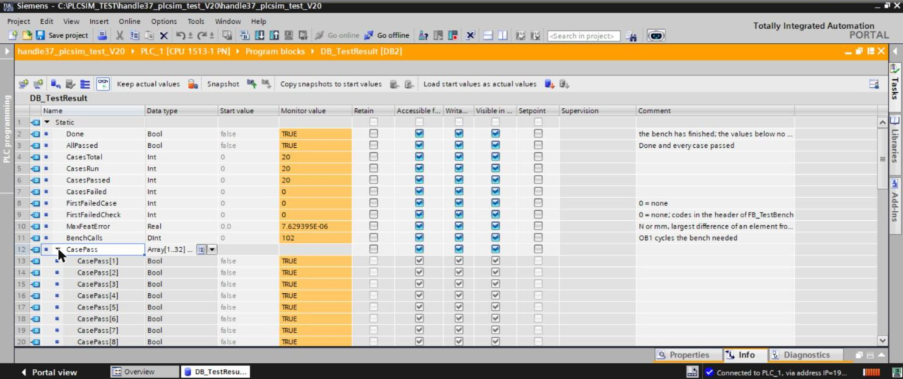
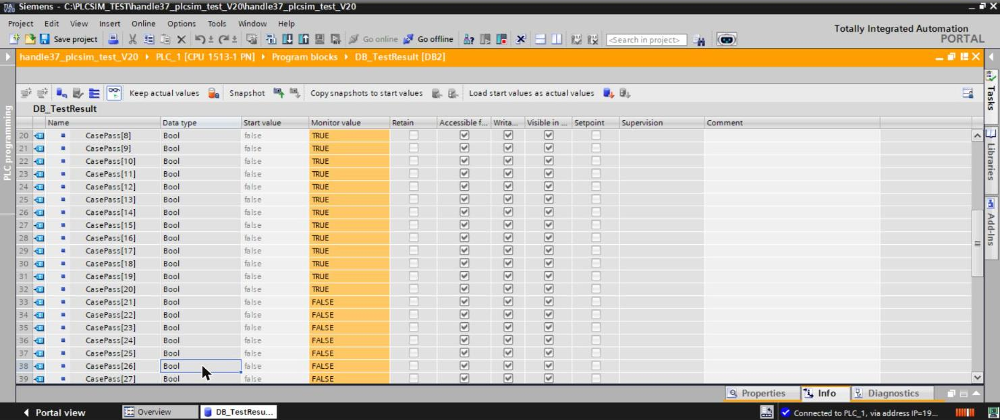
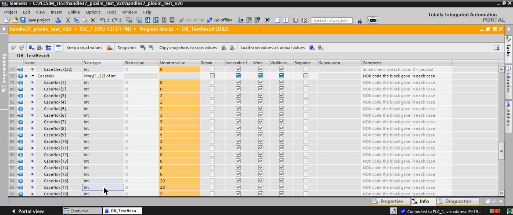
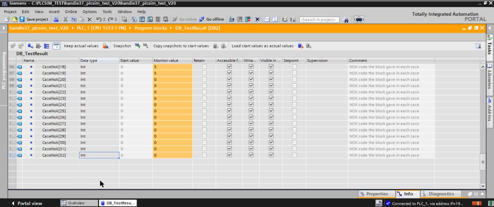
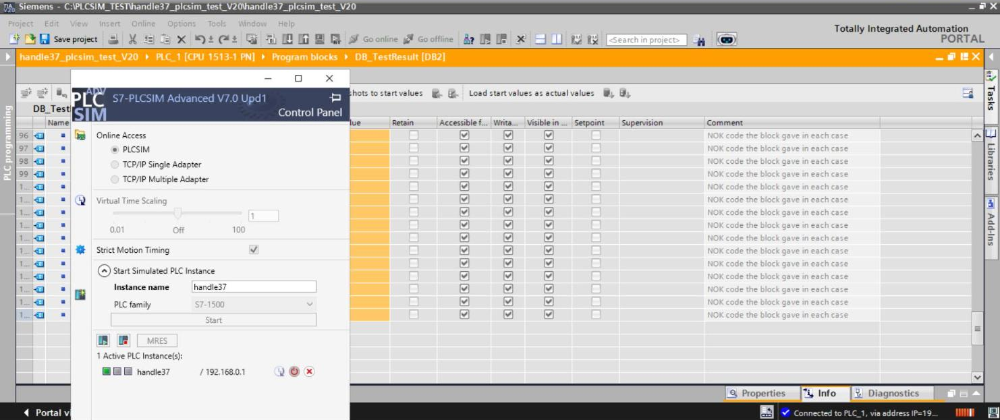

# Running the compiled blocks in S7-PLCSIM

This page is generated from `docs/templates/PLCSIM_RUN.tmpl.md` by `scripts/make_docs.py`.

**Status: run in S7-PLCSIM Advanced on 25 November 2026. 20 of 20 cases passed.** The test project compiles in TIA Portal V18 and the same sources pass in the Python translator. S7-PLCSIM was not available where the project was built, so the run was done on a second installation with TIA Portal V20. The record of that run is the last section of this page; the sections before it were written before the run. A simulated CPU is not a real PLC: no I/O, no real timing.

## What the test bench does

The test project holds the two blocks of the repo, unchanged (`FB_CurveEval`, `FB_HandleStation`), and a test bench from `plc/test/` that runs by itself in OB1. It needs no input, no watch table and no forcing.

| Block | Source | Role |
|---|---|---|
| `DB_TestData` | `plc/test/DB_TestData.scl`, written by `scripts/make_plcsim_bench.py` | 10 recorded force-travel curves from the Python model (5932 samples, 47 kB of Real data), the limits and the envelope of the study, and for every replay case the verdict, NOK code and element values of the NumPy evaluation |
| `FB_TestPlant` | `plc/test/FB_TestPlant.scl` | Stand-in for axis, clamp and handle: the force comes from a recorded curve at the present travel |
| `FB_TestBench` | `plc/test/FB_TestBench.scl` | Runs the cases, compares, counts |
| `DB_TestResult` | `plc/test/DB_TestResult.scl` | The result. This is the block to look at |
| `InstTestBench`, `Main` (OB1) | `plc/test/OB_Main.scl` | Instance of the bench and its call in every cycle |

Part 1, 14 replay cases. A recorded curve goes sample by sample into `FB_CurveEval`: the pull samples, then the return samples. After the last sample the bench compares the verdict, the NOK code, the nine elements (FpG1, FrG1, FMean, FHyst, FpG2, FPeak, XPeak, FStep, XStop) and the two envelope counts with the values in `DB_TestData`. An element may differ by 0.001 (N or mm). The generator refuses a case that lies closer than 0.02 to a limit it is judged by, so a difference in the last bit cannot turn a verdict.

Part 2, 6 station cases. `FB_HandleStation` runs against `FB_TestPlant` with 2 ms of station time per scan. 5 units are judged; all but the RH unit are pulled.

| Case | What runs | Evaluation mode | Expected verdict | Expected NOK code (`CaseNok`) |
|---|---|---|---|---|
| 1 | Replay: good, nominal part | 3 (windows + return stroke) | OK | 0 |
| 2 | Replay: good, random part | 3 (windows + return stroke) | OK | 0 |
| 3 | Replay: missing spring | 3 (windows + return stroke) | NOK | 2 |
| 4 | Replay: weak spring, 70 % wind-up (below the 30 g limit) | 3 (windows + return stroke) | NOK | 2 |
| 5 | Replay: wrong-variant spring (1.6 mm wire) | 3 (windows + return stroke) | NOK | 2 |
| 6 | Replay: binding pivot, +0.35 N m | 3 (windows + return stroke) | NOK | 3 |
| 7 | Replay: latch lever unhooked | 3 (windows + return stroke) | NOK | 5 |
| 8 | Replay: wrong-hand spring | 3 (windows + return stroke) | NOK | 2 |
| 9 | Replay: particle at the end stop, 2.0 mm | 3 (windows + return stroke) | NOK | 9 |
| 10 | Replay: weak spring (70 %) hidden by +0.10 N m pivot friction | 3 (windows + return stroke) | NOK | 2 |
| 11 | Replay: weak spring (70 %) hidden by +0.10 N m pivot friction | 2 (pull-stroke windows) | OK | 0 |
| 12 | Replay: particle at the end stop, 2.0 mm | 1 (peak force only) | OK | 0 |
| 13 | Replay: good, nominal part | 4 (envelope) | OK | 0 |
| 14 | Replay: weak spring, 70 % wind-up (below the 30 g limit) | 4 (envelope) | OK | 0 |
| 15 | Station: good LH unit is clamped, pulled and passed | 3 | OK | 0 |
| 16 | Station: RH unit on an LH recipe is rejected with code 20 and never pulled | 3 | NOK | 20 |
| 17 | Station: the reject lock ignores a chute signal while the part is in the fixture, refuses a new part, and opens when the chute sensor sees a part after the fixture is empty | 3 | stays locked, then opens | 20 |
| 18 | Station: unit with unhooked latch lever is pulled and rejected with code 5 | 3 | NOK | 5 |
| 19 | Station: third reject in a row asks for the master part and blocks the start | 3 | NOK, start blocked | 5 |
| 20 | Station: after the acknowledge a good unit is pulled and passed | 3 | OK | 0 |

The station cases check more than the code: counters, state, that the axis and the clamp did not move for the RH unit, that the lock stayed closed and that the start stayed blocked. The checks are listed in the header of `FB_TestBench.scl`.

## What is known before PLCSIM

- TIA Portal V18, blocks alone: `COMPILE Success errors=0 warnings=0` (`results/tia_compile.txt`).
- TIA Portal V18, whole test project for the same CPU (S7-1513, 6ES7 513-1AL02-0AB0, V2.9): `COMPILE Success errors=0 warnings=0` (`results/tia_compile_testbench.txt`). `Main` is OB 1 in SCL; all blocks are consistent.
- Translator (`tests/test_plcsim_bench.py`, in CI): the same seven source files, data blocks and OB1 included, give **20 of 20 cases passed** after 102 OB1 cycles; largest element difference 9.5e-07.
- The tests also change the data on purpose (a wrong expected element, verdict or code; a station scenario whose defective unit is good; a station block without the reject lock) and check that the bench then reports the right case and check number. So a pass is not empty.

What the translator cannot show: that the S7-1500 computes the Real expressions to the same last digits, and that the compiled blocks behave like their translation. That is what the PLCSIM run is for.

## How to run it

The archive is not in the repo. It is written by:

```
powershell -ExecutionPolicy Bypass -File scripts\tia_build.ps1 -Blocks "FB_CurveEval,FB_HandleStation,test\DB_TestData,test\DB_TestResult,test\FB_TestPlant,test\FB_TestBench,test\OB_Main" -OutDir C:\TIA_build\plcsim -ProjectName handle37_plcsim_test -ArchiveDir C:\TIA_build\plcsim -ArchiveName handle37_plcsim_test.zap18 -ResultFile results\tia_compile_testbench.txt
```

Last build: `C:\TIA_build\plcsim\handle37_plcsim_test.zap18`, 858466 bytes (TIA Portal V18, CPU OrderNumber:6ES7 513-1AL02-0AB0/V2.9, 2026-11-25 04:20). The project is already compiled and has "Support simulation during block compilation" switched on (simulation support during block compilation: True).

1. TIA Portal V18: **Project > Retrieve**, choose `handle37_plcsim_test.zap18`, choose a target folder. The project opens.
2. Select **PLC_1** in the project tree and press **Start simulation** (toolbar, or Online > Simulation > Start). Confirm the message about the online interfaces. S7-PLCSIM starts with an unconfigured CPU.
3. The dialog "Extended download to device" opens: PG/PC interface **PLCSIM**, **Start search**, select the CPU that is found, **Load**. In "Load preview" press **Load**; in "Load results" choose **Start module** and **Finish**.
4. If the CPU is not in RUN, press **RUN** in PLCSIM. The bench starts with the first cycle and is finished within a few seconds.
5. Project tree: **PLC_1 > Program blocks > DB_TestResult**, open it and press **Monitor all**.

To run it again: STOP and RUN in PLCSIM. All data blocks are non-retentive, so the bench starts from the beginning.

If TIA Portal asks to switch on "Support simulation during block compilation" (project properties > Protection), switch it on, compile PLC_1 (Software, rebuild all) and download again.

## Values that mean pass

Monitor values of `DB_TestResult` after the bench has finished:

| Tag | Must show |
|---|---|
| `Done` | TRUE |
| `AllPassed` | TRUE |
| `CasesTotal` | 20 |
| `CasesRun` | 20 |
| `CasesPassed` | 20 |
| `CasesFailed` | 0 |
| `FirstFailedCase` | 0 |
| `FirstFailedCheck` | 0 |
| `CasePass[1]` to `CasePass[20]` | TRUE (`CasePass[21]` to `[32]` stay FALSE) |
| `CaseCheck[1]` to `CaseCheck[32]` | 0 |
| `CaseNok[1]` to `CaseNok[20]` | 0, 0, 2, 2, 2, 3, 5, 2, 9, 2, 0, 0, 0, 0, 0, 20, 20, 5, 5, 0 |
| `MaxFeatError` | below 0.001 (translator: 9.5e-07; the last digits may differ on the CPU) |
| `BenchCalls` | 102 (the bench works a fixed amount per call, so the count does not depend on the cycle time) |

`Done`, `AllPassed`, `CasesPassed = 20` and `CasesFailed = 0` are the verdict; the other rows help if something is different.

A second place to look, not needed for the verdict: `InstTestBench.Station` must show `CntTotal` 5, `CntOk` 2, `CntNok` 3, `CntRejectConfirmed` 3, `State` 0.

If a case fails: `FirstFailedCase` is the case number of the table above and `FirstFailedCheck` says what differed. Replay: 1 verdict, 2 NOK code, 3 FpG1, 4 FrG1, 5 FMean, 6 FHyst, 7 FpG2, 8 FPeak, 9 XPeak, 10 FStep, 11 XStop, 12 envelope nodes outside, 13 envelope nodes evaluated. Station: 21 verdict, 22 NOK code, 23 state, 24 counter, 25 axis or clamp, 26 lock opened too early or a part started while locked, 27 lock not opened by the chute, 28 master-part request, 29 time-out. `Done` staying FALSE means the bench did not finish: note `CasesRun` and `BenchCalls`.

## Record of the PLCSIM run

Run on 25 November 2026 on a second installation, not on the build machine. That installation has TIA Portal V20 and S7-PLCSIM Advanced; it has neither TIA Portal V18 nor the standard S7-PLCSIM. The values in this section were read from the screen and typed in; they are not generated.

| | |
|---|---|
| Date | 2026-11-25 |
| TIA Portal | Totally Integrated Automation Portal, Version V20 Update 7; STEP 7 Professional, Version V20 Update 7 (as listed under "Installed software") |
| S7-PLCSIM | S7-PLCSIM Advanced V7.0 Upd1 (title of its control panel). Online access "PLCSIM", one instance, PLC family S7-1500 |
| CPU in PLCSIM | The project's CPU 1513-1 PN (6ES7 513-1AL02-0AB0, V2.9) loaded into that instance. The search found it as "CPUcommon" at 192.168.0.1 |
| Archive used | `handle37_plcsim_test.zap18`, the build named under "How to run it". The file size was not read on the run machine |
| Upgrade | TIA Portal V20 reported "The project has a TIA Portal project version V18" and upgraded the project to V20 before it opened. The run therefore executed code generated by the V20 compiler, not by the V18 compiler of the build record |
| V20 compile, hardware (rebuild all), project as retrieved | **3 errors, 1 warning.** Errors: "If access control via access level is enabled and a higher access level (= access without login) than full access (..." (cut off on the screen); "Password for confidential PLC configuration data is not configured in the PLC."; "The PLC communication certificate cannot be configured without the password for confidential PLC configuration..." (cut off on the screen). Warning: "The S7-1500 CPU display does not contain any password protection." |
| Changed by hand in the project | PLC_1 > Properties > Protection & Security: "Protect confidential PLC configuration data" switched off, no password set; Access control from "No access (complete protection)" to "Full access (no protection)". Nothing else: no block, no data block, no expected value |
| V20 compile, hardware (rebuild all), after that | 0 errors, 2 warnings: "PLC_1 does not contain a configured protection level" and "The S7-1500 CPU display does not contain any password protection." |
| V20 compile, software (rebuild all) | 0 errors, 0 warnings. All 8 blocks: "Block was successfully compiled." |
| Load | "Loading completed (errors: 0; warnings: 0)", then "PLC_1 started." The instance showed RUN (green) at 192.168.0.1 |

The build record `results/tia_compile_testbench.txt` lists a compile of the program blocks only. The hardware configuration was compiled for the first time in this run, which is why the two protection settings had not come up before. They belong to this simulation project only; do not copy them to a real PLC.

What differed from "How to run it":

- The V20 Project menu showed no "Retrieve" entry with no project open. **Project > Open > Browse** accepts the `.zap18` file, asks for a target directory and retrieves it.
- There is no "Start simulation" path into S7-PLCSIM Advanced. The instance was created and started in the S7-PLCSIM Advanced control panel first. Then **Online > Extended download to device**, PN/IE, PG/PC interface PLCSIM.
- One more confirmation came up before the load preview: "Establish connection to device", with the text that "PLC_1" might not be a trustworthy device (the IP address does not match the certificate; unknown, self-signed certificate). Answered with **Connect**.
- The load preview said "The loading will be performed from a simulated PLC." and needed no further choice. In the load results the action for "Start modules" stood at "No action" and was set to **Start module**.
- TIA Portal did not ask for "Support simulation during block compilation"; the archive has it switched on.

Monitor values of `DB_TestResult` ("Monitor all", CPU in RUN):

| Tag | Must show | Observed |
|---|---|---|
| `Done` | TRUE | TRUE |
| `AllPassed` | TRUE | TRUE |
| `CasesTotal` | 20 | 20 |
| `CasesRun` | 20 | 20 |
| `CasesPassed` | 20 | 20 |
| `CasesFailed` | 0 | 0 |
| `FirstFailedCase` | 0 | 0 |
| `FirstFailedCheck` | 0 | 0 |
| `MaxFeatError` | below 0.001 | 7.629395E-06 |
| `BenchCalls` | 102 | 102 |
| `CasePass[1]` to `CasePass[20]` | TRUE | TRUE, all 20 |
| `CasePass[21]` to `CasePass[32]` | FALSE | FALSE, all 12 |
| `CaseCheck[1]` to `CaseCheck[32]` | 0 | 0, all 32 |
| `CaseNok[1]` to `CaseNok[20]` | 0, 0, 2, 2, 2, 3, 5, 2, 9, 2, 0, 0, 0, 0, 0, 20, 20, 5, 5, 0 | 0, 0, 2, 2, 2, 3, 5, 2, 9, 2, 0, 0, 0, 0, 0, 20, 20, 5, 5, 0 |
| `CaseNok[21]` to `CaseNok[32]` | not used | 0, all 12 |

Result: pass. 20 of 20 cases, every verdict and every NOK code as expected, and the number of bench calls is the one the translator gives.

`MaxFeatError` is larger on the simulated CPU than in the translator (7.6e-06 against 9.5e-07) and 130 times below the tolerance of 0.001. The observed value is 2^-17 (7.62939453125e-06), the spacing of 32-bit Real numbers between 64 and 128, so it fits a difference of one last bit in one element. Which element it was, was not looked up. The generator's margin of 0.02 to every limit is what keeps such a difference away from the verdicts, and no verdict changed.

Not looked at in this run: the counters in `InstTestBench.Station` named above as a second place to look.

What this does and does not show. It shows that the two blocks, compiled by TIA Portal V20 for the CPU 1513-1 PN and executed by the simulated S7-1500, give the verdicts, NOK codes and element values of the NumPy evaluation for the 14 recorded curves, and that the station sequence passes its 6 cases. It does not show anything about a real PLC, real I/O, the cycle load of a 2 ms interrupt or a real rig.

`DB_TestResult` in "Monitor all", scalar values and the first cases:



The same block scrolled down, `CasePass[8]` to `CasePass[27]`:



`CaseNok[1]` to `CaseNok[18]`, and the rest of the array:





S7-PLCSIM Advanced control panel with the instance in RUN, in front of the monitored block:


